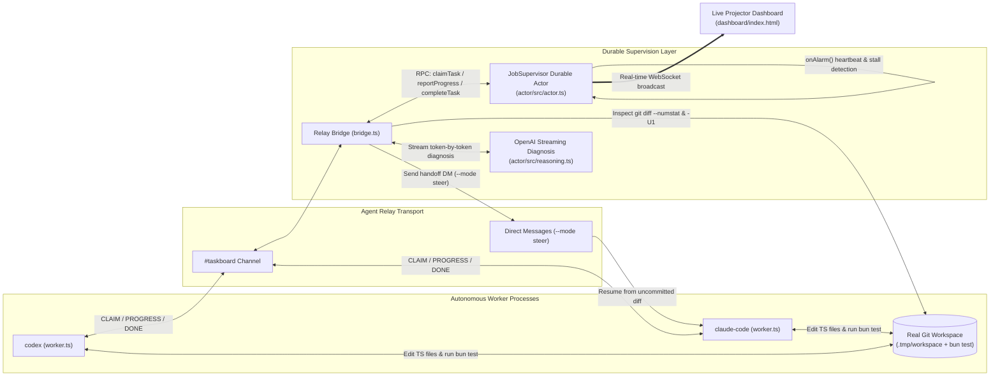

# Graveyard Shift

**A durable supervisor for autonomous coding agents — built on Terse Durable Actors, Agent Relay, and OpenAI live streaming.**

When you leave multiple coding agents (`codex`, `claude-code`) working on a repository overnight, two things go wrong:
1. **File collisions:** Two agents edit `src/auth.ts` at the same time and overwrite each other's uncommitted changes.
2. **Silent stalls:** An agent hits a rate limit, context ceiling, or hung test runner midway through a patch—leaving half-written code on disk and downstream tasks blocked until morning.

**Graveyard Shift** supervises multi-agent software jobs through to completion: preventing concurrent file collisions, detecting silent stalls via durable alarms, inspecting the real `git diff` left behind by a crashed worker, streaming a live OpenAI handoff diagnosis, and steering a surviving agent via **Agent Relay** to finish from the uncommitted diff.

---

## Architecture



### 1. Terse Durable Actor (`actor/src/actor.ts`)
- **Single-Threaded File-Lock Collision Guard:** Every task declares the files it touches (e.g., `src/auth.ts`). When an agent calls `claimTask()`, the actor atomically checks whether any currently claimed task holds an overlapping file lock. Conflicting claims are blocked before a merge conflict can happen, routing the agent to an unlocked task.
- **Self-Rescheduling Heartbeat Alarms (`onAlarm()`):** The supervisor wakes itself on a durable schedule (`heartbeatMs = 3000ms`), checks every active claim against `stallAfterMs = 12000ms`, reclaims stalled tasks automatically, and stands down once all tasks reach `done`.
- **Real-Time WebSocket State Broadcast:** Every claim, progress checkpoint, file-lock block, reclaim, and streaming reasoning token is broadcast directly from the actor to connected browsers.

### 2. Agent Relay (`bridge/src/relay.ts`, `bridge/src/bridge.ts`, `bridge/src/worker.ts`)
- **Separate OS Processes & Identities:** `codex` and `claude-code` run as independent worker processes with their own Agent Relay tokens (`RELAY_CODEX_TOKEN`, `RELAY_CLAUDE_TOKEN`), coordinating over `#taskboard`.
- **Direct Handoff Steering (`--mode steer`):** When `codex` stalls mid-edit, the supervisor sends an Agent Relay `steer` DM to `@claude-code` containing the uncommitted diff summary and test status so `claude-code` resumes from `codex`'s partial patch instead of starting over from scratch.

### 3. Real Git Diffs, `bun test` Verification & OpenAI Streaming (`bridge/src/workspace.ts`, `actor/src/reasoning.ts`)
- **Live Git Workspace:** Workers edit real TypeScript modules (`src/auth.ts`, `src/session.ts`, `src/token.ts`, `src/http.ts`, `src/parse.test.ts`) inside `.tmp/workspace` and execute `bun test`.
- **Grounded Reclaim Diagnosis:** On a stall, the bridge runs `git diff --numstat` and `git diff -U1` against the stalled task's files, extracts the modified symbol (`verifyToken()`) and line count (`18 lines modified in src/auth.ts`), and streams a live OpenAI diagnosis into the dashboard banner.

---

## Repository Structure

| Path | Description |
| :--- | :--- |
| [`actor/src/actor.ts`](actor/src/actor.ts) | `JobSupervisor` Terse Durable Actor: task state machine, File-Lock Collision Guard, durable alarm loop, and live WebSocket broadcast |
| [`actor/src/reasoning.ts`](actor/src/reasoning.ts) | OpenAI streaming reclaim diagnosis, Agent Relay `steer` DM builder, and AI goal-to-DAG task decomposition |
| [`bridge/src/bridge.ts`](bridge/src/bridge.ts) | Two-way bridge between Agent Relay (`#taskboard` + `steer` DMs), git workspace inspection, and the `JobSupervisor` actor |
| [`bridge/src/worker.ts`](bridge/src/worker.ts) | Autonomous worker process (`codex` / `claude-code`) that claims tasks, edits TypeScript files, runs `bun test`, and responds to `steer` DMs |
| [`bridge/src/workspace.ts`](bridge/src/workspace.ts) | Real git workspace manager (`git init`, `git diff`, `bun test`) for verifiable agent checkpoints |
| [`bridge/src/relay.ts`](bridge/src/relay.ts) | Agent Relay CLI transport with write-through local mirror for sub-15ms local delivery |
| [`dashboard/server.ts`](dashboard/server.ts) | Bun HTTP server serving the live dashboard, WebSocket grants, `/api/seed`, and `/api/stall` |
| [`dashboard/index.html`](dashboard/index.html) | Zero-dependency live projector UI with heartbeat ring, per-card stall meters, file-lock strips, and streaming diagnosis banner |
| [`demo.ts`](demo.ts) | One-command stage launcher that seeds the actor and boots the dashboard, bridge, and both worker processes |

---

## Quickstart

### Prerequisites
- [Bun](https://bun.sh) v1.1+
- `terse` CLI (`terse actor dev`)
- `relay` CLI ([Agent Relay](https://agent-relay.com))

### 1. Configure Environment
Provide your Relay tokens in `.env` and your OpenAI API key in `actor/.env`:

```bash
# .env
RELAY_CHANNEL=taskboard
RELAY_SUPERVISOR_TOKEN=...
RELAY_CODEX_TOKEN=...
RELAY_CLAUDE_TOKEN=...

# actor/.env
OPENAI_API_KEY=sk-...
```

### 2. Start the Durable Actor Runtime
```bash
cd actor && terse actor dev
```

### 3. Launch the Full Demo Stack
From the repository root:

```bash
# Run with the default 4-task auth & retry job graph:
bun run demo.ts

# Or AI-decompose any custom engineering goal into a file-locked task graph:
bun run demo.ts "add rate limiting to the public API"
```

Open **`http://localhost:3100`** to watch the live supervisor dashboard.

### Live Stage Hotkeys
- **`R`** — Reset & re-seed the 4-task job graph (resets git workspace, Relay mirror, and actor state)
- **`K`** — Force an immediate stall on `codex`'s active task to trigger a live reclaim & `steer` handoff on demand
